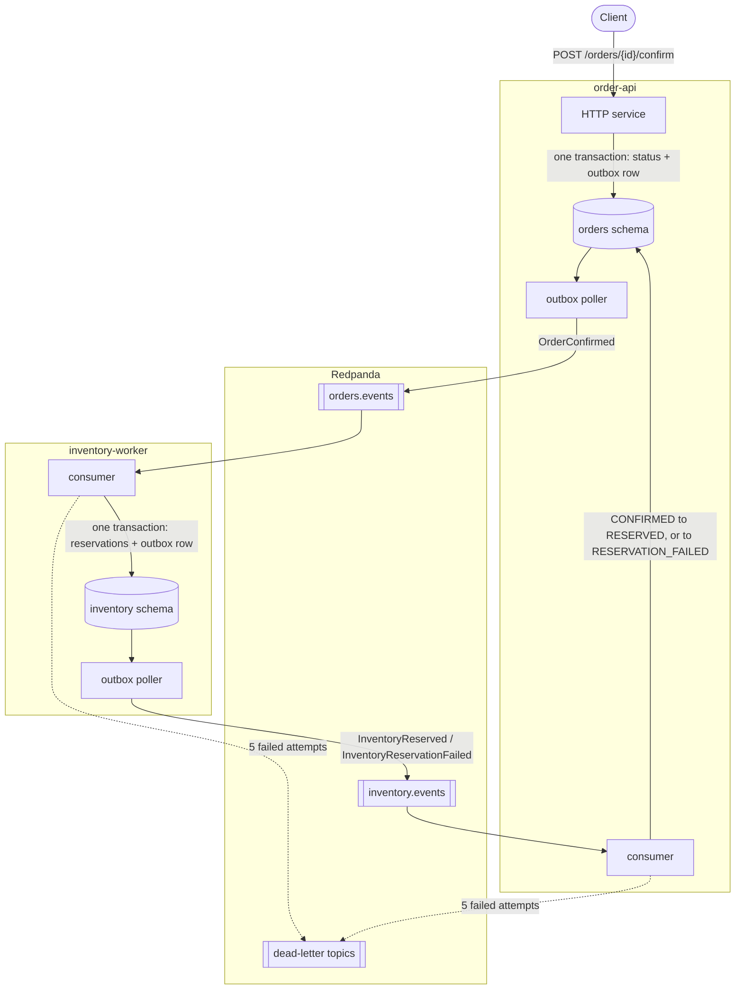
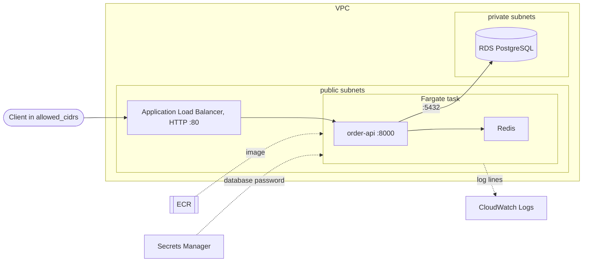

# event-driven-orders

[](https://github.com/ikuko-otani/event-driven-orders/actions/workflows/ci.yml)

An order-management system split into two services that share no database and never call each other.
`order-api` takes an order and confirms it, `inventory-worker` reserves the stock, and everything between them travels through Kafka.

The subject of the project is the machinery that makes that safe: a transactional outbox, a choreographed Saga with compensation, at-least-once delivery absorbed by consumer-side deduplication, and a retry policy that ends in a dead-letter topic.
All of it is first-party code rather than a framework feature, so its failure modes are visible and are exercised by the test suite.

## Architecture

Five processes, two schemas in one PostgreSQL instance, and two business topics.
No arrow crosses from one service's database to the other: the only path between them is the broker.



A confirmed order is answered `200` immediately and reserved asynchronously, so the client learns the outcome by polling `GET /orders/{id}`.
The status it ends on is `RESERVED`, or `RESERVATION_FAILED` when a line has insufficient stock — a business failure, which is a final answer rather than something to retry.
A technical failure is retried in place five times with exponential backoff and is copied to a dead-letter topic only after the last attempt.

Each poller is a singleton on purpose: two of them would publish one order's events out of order.
Details, including why the reservation reply is keyed by order id, are in [the design document](docs/design/domain-design.md).

## Quick start

Requirements: Docker, [uv](https://docs.astral.sh/uv/), and Python 3.12 (pinned by `.python-version`).

```bash
docker compose up -d   # the infrastructure, both migrations, and the five processes
uv run poe seed        # one sales entity, two customers, three items and their stock
uv run poe smoke       # create an order, confirm it, and wait for RESERVED
```

The first command is the whole stack.
It applies both Alembic histories in one-shot services of their own, creates the four topics with the partition counts the design fixes, and only then starts the processes that depend on them — so a fresh clone reaches a working state without a manual step in the middle.

`seed` and `smoke` run on the host rather than in a container.
The seed is two scripts, one per schema, and each imports only the package of the service that owns its schema, so neither reaches into the other's data (design §3.1).
That is what lets the orders half run inside the `order-api` image when the service is deployed.
Together, though, the seed and the smoke need both packages, while each image is built with the dependencies of one.

Once the stack is up:

| What | Where |
|---|---|
| API documentation | <http://localhost:8000/docs> |
| Health | <http://localhost:8000/health> |
| Traces | <http://localhost:16686> (Jaeger) |
| Logs | `docker compose logs -f order-api-poller inventory-worker` |

A one-shot service is hidden by `docker compose ps` once it has finished; `docker compose ps -a` lists it, and `Exited (0)` is its success state rather than a failure.

[A walkthrough](docs/demo.md) drives both outcomes through the running stack — one order reserved, one refused for insufficient stock — with the commands and their real output.

## Deploying to AWS

The HTTP service and its database can be deployed with the Terraform in `infra/terraform` ([ADR-003](docs/adr/003-aws-deployment-shape.md)).
Only the synchronous slice goes there: `order-api` runs as one ECS Fargate task behind an Application Load Balancer, with PostgreSQL on RDS in a private subnet and Redis as a second container in the same task.
The broker, the pollers and `inventory-worker` stay in local Compose, so an order confirmed on AWS stays `CONFIRMED`.



Each hop is opened by a security group that names the one before it: the load balancer accepts port 80 from `allowed_cidrs` only, the task accepts port 8000 from the load balancer only, and the database accepts port 5432 from the task only.
The endpoint has no authentication; it is closed to every address outside `allowed_cidrs`, and it exists only between an `apply` and a `destroy`.
It serves plain HTTP because a certificate needs a domain: a production deployment would add port 443 with an ACM certificate and redirect port 80 to it.

Requirements: Terraform 1.16, the AWS CLI signed in to the target account, and Docker.
There is no automated deployment, because a deploy job would fail every time the stack has been destroyed; the steps are run by hand.

```bash
export AWS_PROFILE=<your profile>
tf="terraform -chdir=infra/terraform"
tag=$(git rev-parse --short HEAD)
vars=(-var "allowed_cidrs=[\"$(curl -s https://checkip.amazonaws.com)/32\"]" -var "image_tag=$tag")

# The image repository first, so there is somewhere to push to
$tf init
$tf apply -target=aws_ecr_repository.api "${vars[@]}"

# The image, built for the platform the task runs on and tagged with the commit
repo=$($tf output -raw ecr_repository_url)
aws ecr get-login-password | docker login --username AWS --password-stdin "${repo%%/*}"
docker build --platform linux/amd64 -f services/order-api/Dockerfile -t "$repo:$tag" .
docker push "$repo:$tag"

# Everything else; the database alone takes several minutes
$tf apply "${vars[@]}"
```

The schema and the master data are applied by one-shot tasks, migrate first:

```bash
net="awsvpcConfiguration={subnets=[$($tf output -json task_subnet_ids | tr -d '[]" ')],securityGroups=[$($tf output -raw task_security_group_id)],assignPublicIp=ENABLED}"
for job in migrate seed; do
  arn=$(aws ecs run-task --cluster event-driven-orders --launch-type FARGATE \
    --task-definition "event-driven-orders-$job" --network-configuration "$net" \
    --query "tasks[0].taskArn" --output text)
  aws ecs wait tasks-stopped --cluster event-driven-orders --tasks "$arn"
  aws ecs describe-tasks --cluster event-driven-orders --tasks "$arn" --query "tasks[0].containers[0].exitCode"
done
aws logs tail /ecs/event-driven-orders --since 10m --log-stream-name-prefix event-driven-orders/seed
```

Each job should report exit code `0`, and the seed prints the ids it wrote.
They are derived from fixed codes, so they are the same as the ids a local seed prints.
The API then answers over HTTP at the address `$tf output -raw alb_dns_name` prints, with its documentation at `/docs`.

A new version is a new commit: the repository refuses a second push under a tag it already holds, so the tag in the task definition always names the code that runs.

```bash
$tf destroy "${vars[@]}"
```

`destroy` needs the same two variables as `apply`.
Afterwards, the tag-based resource search keeps listing deleted resources for a while — the ECS cluster stays visible as `INACTIVE` — so confirm with each service directly that nothing is left.
A 29-minute deployment on 2026-10-20 cost about USD 0.04 in Cost Explorer, more than half of it the load balancer, whose hourly charge does not depend on traffic.

## Repository layout

| Path | Contents |
|---|---|
| `services/order-api` | the HTTP service, its poller and its consumer, and the `orders` Alembic history |
| `services/inventory-worker` | the reservation consumer, its poller, and the `inventory` Alembic history |
| `libs/common` | what the two share: the envelope, the poller loop, the consumer loop, settings, logging and tracing |
| `tests` | one suite for both services, run against real containers |
| `scripts` | the seed and the smoke check |
| `infra/terraform` | the Terraform for deploying the HTTP service to AWS (ADR-003): the network, the load balancer, ECS, RDS, ECR, the execution role and the log group |

The loops are shared code; the schemas are not.
Each service owns its own `outbox` and `processed_events` tables, because each of them is both a producer and a consumer.

## Design documents

The design was written before the implementation and is the specification the code follows.

- [Domain design](docs/design/domain-design.md) — the ER diagram, the event catalog and envelope, the Saga and its compensation path, the outbox poller loop, the retry and dead-letter policy, and the scale assumptions the partition count comes from.
- [ADR-001: Kafka as the event broker](docs/adr/001-kafka-as-event-broker.md)
- [ADR-002: Custom outbox poller over Debezium CDC](docs/adr/002-custom-outbox-poller-over-debezium.md)
- [ADR-003: AWS deployment shape](docs/adr/003-aws-deployment-shape.md) — ECS Fargate for the HTTP service, with the broker kept local.
- [Technical debt](docs/tech-debt.md) — the known gaps, each with what it would take to close it. Two things the design describes are not implemented, and they are registered there rather than left to be found.

## Development

| Command | What it does |
|---|---|
| `uv run poe check` | format, lint, typecheck, test — the local gate |
| `uv run poe ci` | the same, with the formatter reporting a diff instead of fixing it |
| `uv run poe test` | the test suite alone |

The suite starts PostgreSQL, Redis and Redpanda as testcontainers, so it needs Docker but not the Compose stack, and it runs on the host because the container reaper cannot start from inside a container.
CI runs that gate and, in a job of its own, the smoke check above: the same script, driven through the processes Compose starts rather than reassembled from calls a test makes in order.
A third job checks the Terraform with `fmt`, `init -backend=false` and `validate`, none of which needs AWS credentials.
